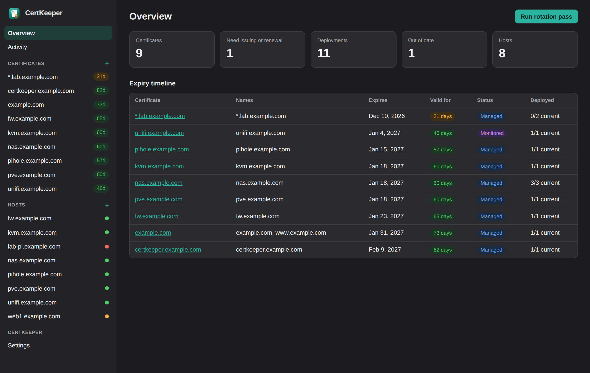

# CertKeeper

CertKeeper issues Let's Encrypt certificates using Cloudflare DNS-01 validation and keeps them current on
your servers and devices over SSH: nginx, Apache, Proxmox VE, TrueNAS and its apps, UniFi OS, OPNsense,
Pi-hole and more. It keeps an inventory, so it only renews and redeploys when needed, and it checks what
each service actually serves.

CertKeeper is a TrueNAS app with a web interface. Its image is `ghcr.io/mjwaters1985/certkeeper`.



More screenshots: [a certificate](docs/screenshots/2-certificate.png),
[a host with discovered certificates](docs/screenshots/3-host.png),
[activity](docs/screenshots/4-activity.png), [its own HTTPS certificate](docs/screenshots/6-own-certificate.png),
[on a phone](docs/screenshots/5-phone.png). They show demo data from `tools/demo/run.sh`.

## Documentation

* **[Installing and running CertKeeper](docs/server.md)**: installing it from the TrueNAS app catalog,
  first start, HTTPS for the web interface, its own address and port 443, backups, updates and
  troubleshooting.
* **[The Cloudflare API token](docs/cloudflare-token.md)**: the permissions it needs and how to create it.
* The rest of this page: how CertKeeper works and what it supports.

## How it works

```
CertKeeper (TrueNAS app)                               Hosts
 ├─ ACME client ──► Let's Encrypt                       nginx · Apache · Proxmox VE · TrueNAS
 ├─ Cloudflare API ──► _acme-challenge TXT records      UniFi OS · OPNsense · Pi-hole · apps
 └─ ssh ────────────────────────────────────────────►   install script per target
```

* **Issuing happens in CertKeeper.** Hosts never see the Cloudflare token and don't need an ACME client.
* **Secrets are stored encrypted**: the Cloudflare token, the ACME account key, each certificate's private
  key and host passwords, in an AES-GCM file (see [Secrets](docs/server.md#secrets)).
* **SSH uses OpenSSH** with CertKeeper's own key, which it creates on first start, and/or a stored
  password per host. Keys are tried first. Connections are reused for a minute. A host's key is trusted the
  first time CertKeeper connects and checked after that.
  * *Password login:* ssh runs CertKeeper's own binary as its `SSH_ASKPASS` helper. The password reaches it
    only through that ssh process's environment, never as an argument or over the network, and only
    password prompts are answered (never key passphrases or host-key questions).
  * *sudo:* CertKeeper first tries `sudo -n`. Only if that fails does it run `sudo -k -S` with the password
    on the first line of input, so the password can never reach the shell as a command.
* **The rotation pass** runs every 12 hours (Settings › Let's Encrypt), or when you choose
  **Run rotation pass**:
  1. A certificate is issued or renewed when it has never been issued, is within its renewal window
     (30 days before expiry by default), has expired, or its list of names has changed.
  2. Every deployment is checked: CertKeeper reads the certificate the service is actually using, from the
     host and from its TLS endpoint if one is set, and compares SHA-256 fingerprints. It also checks that
     the endpoint sends the full chain.
  3. Any deployment that isn't serving the current certificate is redeployed.

## Targets

| Target | What the built-in script does |
|---|---|
| nginx | Backs up and replaces the certificate and key files, runs `nginx -t` (rolling back on failure), then reloads. A separate nginx instance (its own `-c`/`-p`, such as a KVM's web UI) is tested and reloaded on its own |
| Apache | Same as nginx, using `apachectl -t` and a graceful reload. The full chain goes in `SSLCertificateFile` unless a chain path is set |
| Proxmox VE | `pvenode cert set … --force 1 --restart 1` (the custom pveproxy certificate; the cluster CA is untouched) |
| TrueNAS | Imports through `midclt`, then sets it for the web UI and/or catalog apps (see below), deletes old copies nothing uses, and restarts the UI |
| Pi-hole (v6) | Writes the key and full chain into FTL's TLS file (`webserver.tls.cert`, default `/etc/pihole/tls.pem`), optionally sets `webserver.domain` to the certificate's name, then restarts `pihole-FTL` (or its Docker container) |
| App (cert files) | For apps that read their own certificate files (qBittorrent, Jellyfin, Compose stacks…). Writes PEM files or a PKCS#12 file (optionally `chown`ed, e.g. to `568:568`), then redeploys the TrueNAS app, restarts the container, Compose project or systemd unit, or runs your reload command |
| UniFi OS | Replaces `unifi-core.crt` and `.key` (found automatically) and restarts `unifi-core` |
| OPNsense | Imports into System › Trust (reusing the previous CertKeeper entry), sets it as the web GUI certificate and runs `configctl webgui restart` |
| Device (HTTPS API) | For devices without SSH (hosts with the *Device API* connection; see below) |
| Custom | Your own script |

Every deployment's script can be replaced with your own (*Customize install script*). Scripts run with
`sh` on the host and get these variables:

| Variable | |
|---|---|
| `$CERT`, `$CHAIN`, `$FULLCHAIN`, `$KEY` | Temporary files with the new certificate, its chain, both together, and the private key |
| `$TARGET_CERT`, `$TARGET_KEY`, `$TARGET_CHAIN` | The paths set on the deployment |
| `$DOMAINS` | The certificate's names, separated by spaces |
| `$CERT_NAME`, `$CERT_SLUG` | A unique label for this copy (for example `certkeeper_www_example_com_20260109120000`) and its stable part |
| `$STAMP` | A timestamp, used in backup names |
| `$CK_OPT_*` | The deployment's options, such as `$CK_OPT_RESTART_TARGET` |

and these helpers: `ck_install SRC DST MODE` (backs up `DST`, keeping the three newest backups, then
replaces its contents), `ck_rollback` (restores what `ck_install` replaced) and `ck_have COMMAND`.

### TrueNAS apps

TrueNAS can't replace an imported certificate in place, so every renewal creates a new certificate entry.

* **Catalog apps** (apps with a *Certificate* setting, TrueNAS 24.10 and later). One TrueNAS deployment can
  cover the web UI and any number of apps. On each deploy:
  1. Apps still using an older CertKeeper copy of the certificate are switched to the new one, along with
     any apps listed in *Catalog apps*. They're updated with `app.update`, which redeploys them.
  2. Old copies are deleted only when neither the web UI nor any app still uses them. A failed app update
     leaves that app's certificate in place and marks the deploy as failed.
  3. Discovery lists each app's certificate. Adopting one adds the app to the existing TrueNAS deployment
     for that certificate.
* **Apps that handle HTTPS themselves** (no TrueNAS certificate setting) use *App (cert files)*. Discovery
  finds **Jellyfin** (`network.xml`, a PKCS#12 file) and **qBittorrent** (`qBittorrent.conf`, PEM files) in
  the app's config volumes. It maps the paths inside the container to real paths on the NAS and picks up
  the file format, restart target and HTTPS port, so adopting needs no manual setup. Reading those volumes
  usually needs *Use sudo* on the host. For other apps or Compose stacks, enter the paths yourself.

### Discovery

**Discover** on a host looks for:

* every running **nginx** (each instance with its own `-c`/`-p`; skipped on TrueNAS, whose nginx is the web UI),
* **Apache** virtual hosts,
* **Pi-hole** v6, native or in Docker (mapped to the host volume),
* **qBittorrent**, native `qbittorrent-nox` (by process, `--profile` or home folder, restarted through its
  systemd unit) or in Docker,
* the **Proxmox VE** pveproxy certificate,
* **TrueNAS**: the web UI's certificate, catalog apps, and apps that serve HTTPS themselves,
* **UniFi OS** consoles and UniFi OS Server,
* the **OPNsense** web GUI certificate,
* **any other TLS service**: for each listening port, it reads the certificate the port serves and finds the
  file that holds it (under `/etc`, `/opt`, `/srv`, `/var/lib`, `/usr/local/etc` and `/home`), with its
  private key and systemd unit. This needs `openssl` and `ss` or `netstat` on the host, and is skipped on
  TrueNAS and OPNsense.

For **Device API** hosts, discovery asks the device's API what it serves.

*Adopt* turns a discovered certificate into a managed one: it reuses a managed certificate that covers the
same names, or creates a new one. It can also adopt a certificate as **monitor only**, for one that another
system renews (UniFi's own ACME client, for example): CertKeeper then only watches its expiry and chain.

### Device API hosts

Some devices, such as an ESP32 board running firmware with this API, have no shell. They install
certificates through a small HTTPS API instead:

* `GET /api/tls` returns the certificate being served: `source` (`installed` or `self-signed`), subject,
  issuer, `not_after`, `sha256` (of the leaf certificate's DER), `dns_names` and `chain_length`.
* `PUT /api/tls/certificate` takes JSON `{"certificate": "<PEM chain, leaf first>", "private_key": "<PEM>"}`.
* Both need `Authorization: Bearer <token>`. CertKeeper stores the token as the host's password.

Until a publicly trusted certificate is installed, the device serves a self-signed one. CertKeeper sends the
token and private keys only to a certificate that chains to a trusted root (the container's CA bundle) and
is valid for the host's name or address, or to the one whose SHA-256 is pinned on the host. **Fetch** in the
host editor reads the fingerprint the device presents now; pin it only if it matches the one the device
itself shows.

## Exporting certificates

**Export…** on a certificate downloads it with its full chain:

| Format | Files | Typical use |
|---|---|---|
| PEM, separate files | `NAME.cert.pem`, `.chain.pem`, `.fullchain.pem`, `.privkey.pem` | nginx, Apache, most Linux tools |
| PEM, single file | `NAME.pem` (private key, then full chain) | HAProxy, Pi-hole, lighttpd |
| PKCS#12 | `NAME.p12` (full chain and key, password protected; AES-256, or 3DES and SHA-1 for older systems) | Windows/IIS, Java, Jellyfin |
| PKCS#7 + key | `NAME.p7b` (full chain) and `NAME.key` (PEM) | Windows, Java |
| DER + key | `NAME.cer`, `NAME.chain-N.cer`, `NAME.key.der` (PKCS#8) | Windows, appliances, Android |

Every format includes the private key, so keep the files safe. PKCS#12 and PKCS#7 files are made with
`openssl` inside the app, in a private temporary folder.

## Exporting and importing the configuration

**Settings › Configuration › Export** downloads hosts, certificates, deployments, settings and ACME account
links as a JSON file; the activity log isn't included. With a password (at least 10 characters), the file
also holds the secrets (the Cloudflare token, ACME account key, certificate private keys, host passwords
and PKCS#12 passwords), encrypted with PBKDF2-SHA256 (600,000 iterations) and AES-256-GCM. Without one it
holds no passwords or keys.

**Import** shows what the file contains and asks before replacing the current configuration. The current
inventory is first saved to `inventory.before-import-<time>.json` in `/config`, and the activity log is kept.
The log then lists any certificates without a private key (issue them again before deploying) and hosts
without a password.

## Building and testing

The app's image builds from the `Dockerfile` (for `linux/amd64`, the platform TrueNAS runs on):

```sh
docker build --platform linux/amd64 -t certkeeper .
```

The tests cover the engine, the server, and the real install and discovery scripts run against stubs.
They run as CI runs them, in a container with the tools the scripts use:

```sh
docker build -t certkeeper-test -f docker/test.Dockerfile docker
docker run --rm --user 568:568 -e HOME=/tmp/home -v "$PWD":/src:ro -w /src certkeeper-test \
  sh -c 'mkdir -p /tmp/home && swift test --scratch-path /tmp/build'

CK_ACME_STAGING=1 swift test --filter ACMEStaging    # live check against Let's Encrypt staging (no DNS changes)
```

## Caveats: check these on your versions

* **UniFi OS Server** (self-hosted, podman-based) has no documented certificate path. CertKeeper looks for
  `unifi-core.crt` in its podman volumes and under `/data`, `/mnt`, `/var/lib`, `/opt` and `/srv`. Set the
  folder on the deployment (*unifi-core folder*) if it picks the wrong one. It restarts `unifi-core` inside
  the `uosserver` container, or the whole `uosserver` service if that fails. UniFi OS Server also renews
  its own Let's Encrypt certificate; to keep that, adopt it as monitor only. Firmware updates on UniFi
  consoles can replace the certificate; the next rotation pass notices and redeploys.
* **OPNsense**: the script edits the legacy `$config` array and calls `write_config()`. It's used on
  OPNsense 26.7, but OPNsense is moving System › Trust to its MVC models, so test it on your version. It
  backs up `/conf/config.xml` first, and OPNsense keeps its own configuration history too. Root's login shell
  on OPNsense is the console menu; non-interactive `ssh … sh -s` passes through it, but a dedicated admin
  user with sudo is more robust.
* **TrueNAS**: uses `midclt` (`certificate.create` with `CERTIFICATE_CREATE_IMPORTED`, `app.query` with
  `retrieve_config`, and `app.update`). It's used on TrueNAS Community Edition 26 and 27 and needs 24.10 or
  later; TrueNAS CORE isn't supported. App updates send back each app's full configuration with only its
  certificate setting changed.

## Support

CertKeeper is a free, one-person project. Problems and ideas go in
[GitHub issues](https://github.com/MJWaters1985/CertKeeper/issues); security problems go
[privately](SECURITY.md). If it saves you time, you can [buy me a coffee](https://buymeacoffee.com/mjwaters1985).

## License

Copyright 2026 Mike Waters. Licensed under the [Apache License, Version 2.0](LICENSE); see [NOTICE](NOTICE).
CertKeeper is built on open-source software listed, with its licenses, in
[THIRD_PARTY_NOTICES.md](THIRD_PARTY_NOTICES.md).
